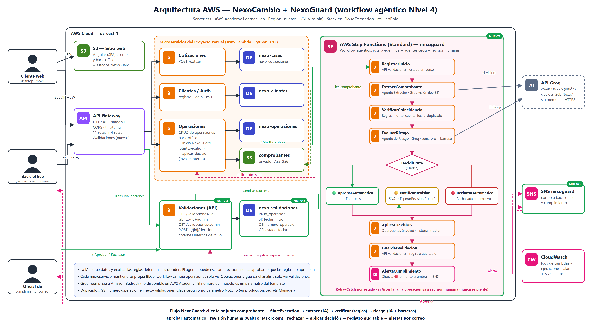

# PARTE B — DISEÑO DEL MVP (CÓMO)

> Proyecto Final · NexoGuard · Nivel 4. Archivos de diseño en el repositorio:
> `statemachine/nexoguard.asl.json` (definición del workflow), `docs/final/arquitectura_nexoguard.svg/.png` (diagrama),
> `docs/final/costos_nexoguard.py/.json` (estimación de costos).

## 1. Diseño de FrontEnd (prototipo)

NexoGuard no crea una web nueva: **extiende la app Angular 22 de NexoCambio** (cliente y back-office) con las pantallas del workflow. El prototipo se diseña con una herramienta de IA a partir de las historias HU10–HU17. Las capturas finales corresponderán a la app Angular conectada a las APIs reales, como en el Proyecto Parcial.

### Prompt utilizado para el prototipo

> Extiende el diseño web responsive de NexoCambio (casa de cambio digital; Casa de Cambio en azul, Cripto en verde oscuro; estilo moderno, minimalista, tipografía sans-serif, tarjetas con bordes suaves) con las pantallas de **NexoGuard**, un agente que valida automáticamente los comprobantes de transferencia:
> - **Cliente — validación en curso:** después de adjuntar el comprobante, una tarjeta «Validando tu comprobante» con 3 pasos animados (Leyendo comprobante → Verificando datos → Evaluando la operación) y el texto «Normalmente toma menos de un minuto».
> - **Cliente — resultado:** si se aprueba, «¡Comprobante validado! Tu operación está en proceso». Si va a revisión, «Un especialista está revisando tu operación». Si se rechaza, el motivo en lenguaje claro y un botón «Adjuntar otro comprobante».
> - **Cliente — detalle de operación:** en la línea de tiempo, el hito «Validado automáticamente por NexoGuard» o «Revisado por un especialista».
> - **Back-office — cola:** una pestaña «En revisión» con contador; cada fila muestra un semáforo (verde, amarillo, rojo), código, cliente, monto y el motivo principal.
> - **Back-office — revisión asistida:** a la izquierda, la imagen del comprobante; a la derecha, una tabla «Declarado en la operación vs. Leído por el agente» (monto, moneda, cuenta destino, fecha, N° de operación) con ✓ o ✗ por fila; debajo, el semáforo con la justificación del agente y la confianza de lectura. Botones «Aprobar» y «Rechazar» (el rechazo exige un motivo, prellenado con el sugerido por el agente).
> - **Back-office — auditoría:** una línea de tiempo de los pasos del workflow con hora, duración y quién decidió (agente u operador).
> Debe verse bien en escritorio, tablet y móvil. Todos los textos en español.

### Pantallas

| Pantalla | Usuario | HU | Descripción |
|---|---|---|---|
| Validación en curso | Cliente | HU10 | Paso 3 del wizard «Nueva operación»: tras confirmar el comprobante muestra el progreso. El front consulta `GET /validaciones/{id}` cada 3 s (máx. ~60 s); si no termina, informa que recibirá el resultado en «Mis operaciones». |
| Resultado de validación | Cliente | HU10, HU14 | Tres variantes: aprobada (verde), en revisión (ámbar) o rechazada con motivo (rojo) y opción de adjuntar otro comprobante. |
| Mis operaciones / Detalle | Cliente | HU10 | Etiqueta «Validando» o «En revisión» mientras la operación está «Pendiente de validación»; hito de NexoGuard en la línea de tiempo. |
| Cola «En revisión» | Back-office | HU15 | Nueva pestaña con las validaciones que esperan decisión (`GET /validaciones/admin?estado=en_revision`), con semáforo y motivo. |
| Revisión asistida | Back-office | HU11–HU13, HU15 | Comprobante y datos extraídos lado a lado, verificaciones ✓/✗, semáforo, justificación y botones Aprobar / Rechazar (`POST /validaciones/{id}/decision`). |
| Auditoría de la validación | Back-office | HU17 | Línea de tiempo de la ejecución y decisión final (`GET /validaciones/{id}/admin`). |

**Estados mostrados.** Para no romper el contrato actual, la operación conserva sus cuatro estados (Pendiente de validación → En proceso → Procesada | Rechazada). Los subestados de NexoGuard vienen de la API Validaciones y el front los combina así:

| Estado de la operación | Estado de la validación | Etiqueta en la interfaz |
|---|---|---|
| Pendiente de validación | `en_curso` | «Validando automáticamente» |
| Pendiente de validación | `en_revision` | «En revisión» |
| En proceso / Rechazada | `finalizada` | Estado normal + hito «por NexoGuard» u «operador» |

## 2. Diseño de BackEnd (workflow y APIs serverless)

### 2.1 Pasos del workflow (AWS Step Functions Standard — `nexo-<stage>-nexoguard`)

El workflow se inicia desde el microservicio Operaciones (`states:StartExecution`) cuando el cliente adjunta el comprobante. El nombre de la ejecución es `<id_operacion>-<timestamp>`, y la entrada es una copia de la operación (id, cliente, montos, monedas, origen, destino, ruta del comprobante en S3 y fecha de creación).

| # | Estado | Tipo | Qué hace | Manejo de errores |
|---|---|---|---|---|
| 1 | `RegistrarInicio` | Task → Lambda Validaciones (`iniciar`) | Crea el registro de la validación con estado `en_curso`. | — |
| 2 | `ExtraerComprobante` | Task → Lambda `guard-extraer` | **Agente Extractor.** Descarga el comprobante de S3 y llama a Groq `qwen/qwen3.8-27b` (visión) con salida JSON. Si es PDF, convierte la 1.ª página a imagen. | `Retry` ante límite de Groq (429): 20 s, ×2, 3 intentos. `Catch` → `ExtraccionFallida` (lectura no concluyente → revisión). |
| 3 | `VerificarCoincidencia` | Task → Lambda `guard-verificar` | Reglas deterministas (ver 2.2). Consulta duplicados en el GSI `numero-operacion-index`. | — |
| 4 | `EvaluarRiesgo` | Task → Lambda `guard-riesgo` | **Agente de Riesgo.** Groq `openai/gpt-oss-20b` asigna semáforo y redacta la justificación; luego el código aplica las barreras y fija la `ruta`. | `Retry` ante 429. `Catch` → `RiesgoNoDisponible` (amarillo → revisión). |
| 5 | `DecidirRuta` | Choice | `aprobar` → `AprobarAutomatico`; `rechazar` → `RechazarAutomatico`; otro → `NotificarRevision`. | — |
| 6a | `AprobarAutomatico` / `RechazarAutomatico` | Pass | Arma la decisión con `decidido_por = agente` y el motivo sugerido. | — |
| 6b | `NotificarRevision` | Task → **SNS publish** (integración directa) | Correo al back-office con código, monto, semáforo y motivo. | Si falla, continúa igual. |
| 6c | `EsperarRevision` | Task → Lambda Validaciones (`registrar_espera`) con **`.waitForTaskToken`** | Guarda el *task token* y el análisis (estado `en_revision`). El workflow queda pausado sin costo hasta que el operador decide. | `TimeoutSeconds` 72 h → `RevisionVencida` (correo de escalamiento). |
| 7 | `AplicarDecision` | Task → Lambda Operaciones (`aplicar_decision`, invocación interna) | Cambia el estado (→ En proceso o Rechazada) y registra en el historial quién decidió. | `Retry` ante errores transitorios de Lambda. |
| 8 | `GuardarValidacion` | Task → Lambda Validaciones (`guardar`) | Registro auditable final (estado `finalizada`). | — |
| 9 | `AlertaCumplimiento` | Choice | Si el semáforo es rojo o el monto supera el umbral → `NotificarCumplimiento`. | — |
| 10 | `NotificarCumplimiento` | Task → **SNS publish** | Alerta al oficial de cumplimiento con la justificación. | Si falla, termina igual. |
| 11 | `Fin` | Succeed | — | — |

Se eligió **Standard** (y no Express) porque `waitForTaskToken` solo existe en Standard y porque guarda el historial visual de cada ejecución, que sirve como auditoría y para la demostración.

### 2.2 Reglas de verificación y decisión

**Principio de diseño:** *la IA lee y explica; las reglas deciden.* El agente de riesgo puede **escalar** una operación a revisión, pero **nunca puede aprobar** algo que las reglas no aprueban.

| Verificación (`guard-verificar`) | Regla | Si no cumple |
|---|---|---|
| Comprobante reconocido | `es_comprobante = true`, `legible = true`, confianza ≥ 0.80 | Revisión |
| Monto | Monto leído = `monto_origen` de la operación (tolerancia 0.01) | **Rechazo** |
| Moneda | Moneda leída = `moneda_origen` | **Rechazo** |
| Cuenta destino | Los dígitos visibles coinciden con una cuenta o CCI de NexoCambio para esa moneda, o el destinatario es «NexoCambio» | **Rechazo** |
| No duplicado | El N° de operación no existe en otra validación (GSI `numero-operacion-index`) | **Rechazo** |
| Fecha | Fecha del comprobante ≥ fecha de creación de la operación (−1 día de tolerancia) | Revisión |
| Banco de origen | Coincide con el banco declarado (si se pudo leer) | Solo informativa |

| Situación | Semáforo | Ruta |
|---|---|---|
| Alguna verificación de **rechazo** no cumple, con confianza ≥ 0.80 | 🔴 Rojo | `rechazar` (motivo generado a partir de la discrepancia) |
| Lectura no concluyente, verificación de revisión no cumple, o el agente marca amarillo o rojo sin una discrepancia dura | 🟡 Amarillo | `revision` |
| Monto ≥ umbral de registro (referencial US$ 10,000 o equivalente) | 🟡 Amarillo + `alerta_cumplimiento` | `revision` |
| Todo cumple y el agente marca verde | 🟢 Verde | `aprobar` |

### 2.3 Agentes de IA (Groq, sin memoria)

| Agente | Modelo | Entrada | Salida (JSON) |
|---|---|---|---|
| Extractor | `qwen/qwen3.8-27b` (visión) | Imagen del comprobante + instrucciones | `es_comprobante, legible, banco_origen, monto, moneda, fecha, hora, numero_operacion, destinatario, cuenta_destino, banco_destino, confianza, observaciones` |
| Riesgo | `openai/gpt-oss-20b` (texto) | Operación + extracción + verificaciones (sin imagen) | `semaforo, justificacion (≤ 3 oraciones en español), motivo_rechazo` |

- Cada llamada es independiente (**sin memoria**): todo el contexto viaja en el prompt. Se usa `temperature = 0` y `response_format = json_object`.
- **Validado el 31-oct-2026** con los 8 comprobantes de prueba: extracción correcta en todos (≈ 4.5 s por imagen). El borroso salió con `legible: false` y confianza 0.35; el ticket, con `es_comprobante: false`.
- Los modelos van como parámetros del template (`GroqModeloVision`, `GroqModeloTexto`), porque Groq retira modelos con frecuencia y `qwen3.8-27b` figura como *Preview*.
- Límite de la capa gratuita: ~7,000 tokens de entrada por minuto, y cada imagen consume ~2,260 (≈ 3 comprobantes por minuto). Se cubre con el `Retry` del paso 2, y en producción se contrataría el plan de pago de Groq.

### 2.4 APIs

**Nueva — Microservicio Validaciones** (Lambda Python 3.12, BD propia `nexo-validaciones`):

| Método | Endpoint | Acceso | Descripción |
|---|---|---|---|
| GET | `/validaciones/{id_operacion}` | JWT (dueño) | Última validación de la operación, versión para el cliente: estado, resultado y motivo. 404 si no existe. |
| GET | `/validaciones/{id_operacion}/admin` | x-admin-key | Todas las validaciones de la operación con el detalle completo (auditoría). |
| GET | `/validaciones/admin?estado=en_revision` | x-admin-key | Cola de revisión (Query al GSI `estado-fecha-index`, de la más antigua a la más reciente). |
| POST | `/validaciones/{id_operacion}/decision` | x-admin-key | `{decision: "aprobar"\|"rechazar", motivo?}` → `SendTaskSuccess` con el token guardado y borrado del token (idempotente: si ya se decidió, responde 409). |
| Invoke | acciones `iniciar`, `registrar_espera`, `guardar` | Interno | Llamadas desde Step Functions; no se exponen en internet. |

**Cambios propuestos al microservicio Operaciones** *(requieren aprobación del equipo: según el CLAUDE.md del repo, el backend existente no se modifica sin consultarlo)*:

1. `POST /operaciones/{id}/comprobante`: después de guardar el comprobante, inicia la ejecución de NexoGuard. Si Step Functions no responde, la operación queda en «Pendiente de validación» y el back-office puede revisarla manualmente como hoy.
2. Nueva acción interna `aplicar_decision` (invocación Lambda → Lambda, igual que `obtener` en Cotizaciones). Aplica la transición Pendiente de validación → En proceso | Rechazada con la misma validación de transiciones del PATCH, y agrega `actor: "agente" | "operador"` al hito del historial.
3. `PATCH /operaciones/{id}/estado` sigue funcionando para En proceso → Procesada (confirmar el envío del dinero) y para operaciones sin validación automática.

### 2.5 Diseño de tablas NoSQL (DynamoDB, bajo demanda)

**Nueva — `nexo-<stage>-validaciones`** (microservicio Validaciones):

| Elemento | Definición |
|---|---|
| PK | `id_operacion` (S) |
| SK | `fecha_inicio` (S, ISO-8601): una operación puede tener varias validaciones si el cliente vuelve a adjuntar el comprobante |
| GSI `numero-operacion-index` | PK `numero_operacion` (S, solo dígitos), con proyección KEYS_ONLY + `id_operacion`: detección de comprobantes duplicados |
| GSI `estado-fecha-index` | PK `estado` (S), SK `fecha_inicio`: cola de revisión del back-office |
| Atributos | `id_cliente`, `ejecucion_arn`, `estado` (`en_curso` \| `en_revision` \| `finalizada`), `extraccion` {…}, `verificaciones` [{regla, cumple, detalle}], `semaforo`, `justificacion`, `ruta`, `alerta_cumplimiento`, `decision` {decision, decidido_por, motivo, fecha}, `estado_final`, `modelos` {vision, texto}, `duracion_ms`, `task_token` (solo mientras espera; se elimina al decidir) |

| Caso de uso | Operación en DynamoDB |
|---|---|
| Iniciar validación | PutItem (`attribute_not_exists`) |
| ¿N° de operación ya usado? | Query al GSI `numero-operacion-index` (excluye la operación actual) |
| Esperar revisión | UpdateItem: `estado = en_revision`, `task_token`, análisis |
| Cola de revisión | Query al GSI `estado-fecha-index` con `estado = en_revision` |
| Decisión del operador | GetItem (token) → `SendTaskSuccess` → UpdateItem condicional (`attribute_exists(task_token)`) que borra el token |
| Consulta del cliente | Query por `id_operacion`, la más reciente (ScanIndexForward = false, Limit 1) + verificación de `id_cliente` |

**Cambio en `nexo-<stage>-operaciones`:** ninguno en las claves. Solo se agrega el atributo `actor` dentro de cada hito de `historial`.

### 2.6 Seguridad y decisiones de diseño

- **LabRole** para las Lambdas y la máquina de estados (en AWS Academy no se pueden crear roles). Hay que verificar al inicio de la Parte C que Step Functions pueda asumirlo.
- **Clave de Groq** como parámetro `NoEcho` de CloudFormation, leída de `.secrets/groq_api_key` por `deploy.sh`. En producción iría en Secrets Manager.
- **Aislamiento de datos:** el workflow nunca escribe directamente en tablas de otro microservicio. Cambia operaciones solo vía Operaciones y guarda análisis solo vía Validaciones.
- **El task token** no sale nunca al navegador: el operador decide por la API y el backend usa el token guardado.
- **Datos mínimos a la IA:** a Groq se envía la imagen del comprobante y montos y monedas; no se envían el documento de identidad, el correo ni el teléfono del cliente.
- **Observabilidad:** logs estructurados de cada Lambda, historial de ejecuciones de Step Functions y una alarma `ExecutionsFailed` conectada al SNS de alertas existente.

## 3. Diagrama de Arquitectura de Solución en AWS

*Figura B.1 — Arquitectura serverless de NexoCambio + NexoGuard (AWS Academy · us-east-1). Los componentes nuevos están marcados con «NUEVO».*

**Flujo:**

1. El cliente adjunta el comprobante.
2. Operaciones lo guarda en S3 e inicia la ejecución (`StartExecution`).
3. El Agente Extractor lee la imagen con Groq.
4. Las reglas verifican la coincidencia.
5. El Agente de Riesgo asigna el semáforo.
6. El workflow aprueba, rechaza o espera al operador (correo SNS).
7. El operador decide en el back-office y la API Validaciones reanuda el workflow (`SendTaskSuccess`).
8. Operaciones aplica la decisión, Validaciones guarda el registro auditable y, si corresponde, se alerta a cumplimiento.

## 4. Región de AWS

Se mantiene **us-east-1 (N. Virginia)**:

- AWS Academy Learner Lab solo habilita us-east-1 y us-west-2.
- NexoCambio ya está desplegado allí (comprobantes, tablas y APIs), y mover el workflow a otra región agregaría latencia y transferencia entre regiones.
- Step Functions, Lambda, DynamoDB y SNS están disponibles y tienen sus precios más bajos en esta región.
- La API de Groq se sirve desde EE. UU., así que la latencia entre la Lambda y Groq es baja.

Para una operación real en Perú convendría evaluar **sa-east-1 (São Paulo)** por cercanía, y revisar con asesoría legal la Ley N.° 29733 de protección de datos personales por el envío de imágenes de comprobantes a un proveedor de IA externo.

## 5. Costos mensuales en AWS

Estimación **incremental** de NexoGuard sobre el costo base de NexoCambio (Proyecto Parcial). Calculada con `docs/final/costos_nexoguard.py`: precios de lista de us-east-1 y de Groq a octubre de 2026, y duraciones medidas en la prueba de Groq. Supuestos: ~10 transiciones por ejecución, 25% de casos a revisión humana y 10% con alerta a cumplimiento.

| Componente | Demo (1,000 validaciones/mes) | Piloto (15,000/mes) | Crecimiento (150,000/mes) |
|---|---:|---:|---:|
| AWS Step Functions (Standard) | US$ 0.16 | US$ 3.84 | US$ 39.27 |
| AWS Lambda (3 agentes + API Validaciones) | 0.04 | 0.57 | 5.71 |
| API Gateway (rutas /validaciones) | 0.01 | 0.15 | 1.50 |
| DynamoDB `nexo-validaciones` | 0.00 | 0.06 | 0.62 |
| SNS (correos) | 0.00 | 0.09 | 1.03 |
| CloudWatch (logs + 1 alarma) | 0.10 | 0.14 | 0.53 |
| **Subtotal AWS NexoGuard** | **US$ 0.32** | **US$ 4.85** | **US$ 48.66** |
| Groq — Agente Extractor (qwen3.8-27b) | 2.92 | 43.80 | 438.00 |
| Groq — Agente de Riesgo (gpt-oss-20b) | 0.25 | 3.71 | 37.12 |
| **Subtotal Groq (externo)** | **US$ 3.17** | **US$ 47.51** | **US$ 475.13** |
| Costo base NexoCambio (parcial) | 0.50 | 1.70 | 13.29 |
| **Total mensual** | **≈ US$ 4.0** | **≈ US$ 54.1** | **≈ US$ 537.1** |
| Costo por validación | US$ 0.0035 | US$ 0.0035 | US$ 0.0035 |

**Lectura de los resultados:**

- **La infraestructura AWS es muy barata:** menos de US$ 5 al mes en el piloto. El costo lo domina **la IA (≈ 90%)**, en particular la lectura de imágenes.
- Validar un comprobante cuesta **≈ US$ 0.0035**, frente a varios minutos de un operador. Con 15,000 operaciones al mes y un 75% aprobado automáticamente, se evitan ~11,000 revisiones manuales.
- **Optimizaciones posibles:** reducir la resolución de la imagen antes de enviarla (menos tokens), acortar `observaciones`, usar un modelo de visión más económico cuando Groq lo ofrezca o una ruta Express para la parte síncrona. En la demo académica, la capa gratuita de Groq deja ese costo en **US$ 0**.

**Datos para la calculadora de AWS (escenario Piloto, us-east-1)** — para generar el enlace oficial de calculator.aws:

| Servicio en calculator.aws | Valores a ingresar |
|---|---|
| AWS Step Functions — Standard Workflows | 15,000 ejecuciones/mes · 10.5 transiciones por ejecución |
| AWS Lambda | 75,000 solicitudes/mes · 256 MB · duración media 1,640 ms (y 15,000 adicionales de 512 MB · 300 ms para Operaciones) |
| Amazon API Gateway — HTTP API | 150,000 solicitudes/mes |
| Amazon DynamoDB — On-Demand | 90,000 escrituras · 45,000 lecturas/mes · 0.1 GB |
| Amazon SNS | 5,250 notificaciones por correo/mes |
| Amazon CloudWatch | 1 alarma estándar · 0.1 GB de logs |

El costo de Groq no aparece en la calculadora de AWS: se reporta aparte como servicio externo.
